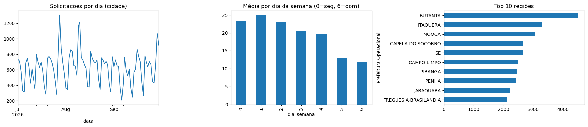
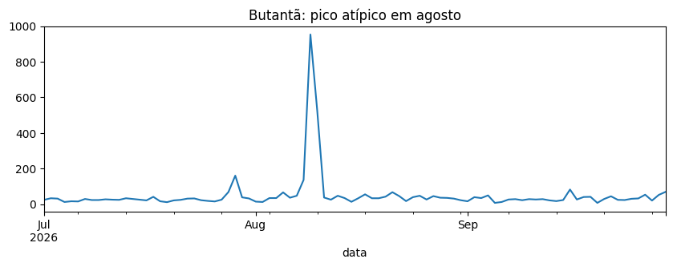
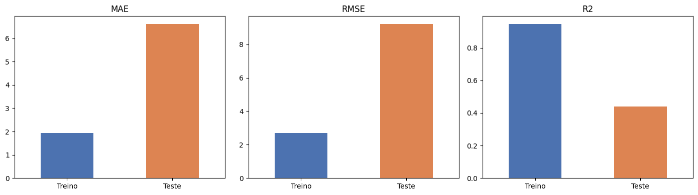
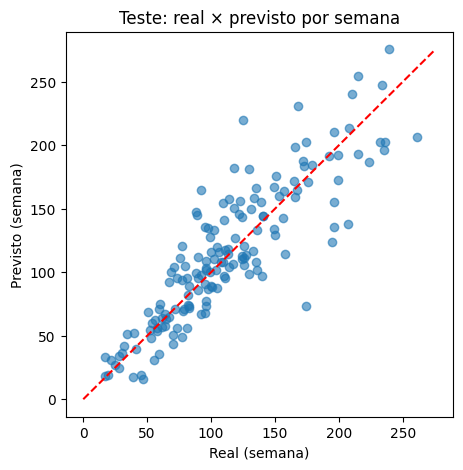
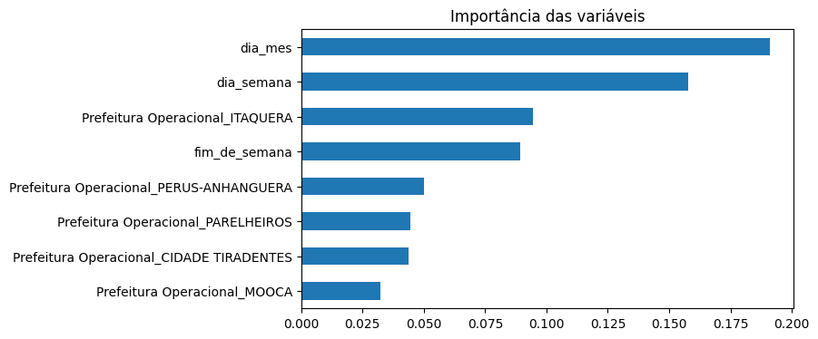

# Relatório de Machine Learning: ColetaCerta

**Previsão de solicitações de limpeza e coleta de lixo por Prefeitura Regional (SP156)**

Projeto da Global Solution CitizenTech. Modelo: Random Forest.

| Integrante | RM |
|---|---|
| Dayana Ticona | 558023 |
| Larissa Biusse | 564068 |
| Rodrigo Leme | 550266 |
| Thamiris Almeida | 559155 |
| Werbeth Nunes | 559067 |

---

## 1. Problema e dados reais

O ColetaCerta monitora lixeiras e registra solicitações de coleta. Para a prefeitura planejar equipes e rotas, é útil saber **quanto trabalho vem pela frente em cada região**. Transformamos isso em uma pergunta de Machine Learning:

> **Quantas solicitações de limpeza e coleta de lixo os cidadãos vão abrir no SP156 em cada Prefeitura Regional, por dia e por semana?**

É um problema de **regressão**: o alvo é o número de solicitações por dia em cada região. A previsão semanal, somada a partir das diárias, é o que a API do ColetaCerta devolve ao cliente (rota `/previsao?regiao=Ipiranga`).

**Dados.** Usamos dados reais e públicos do **SP156 – Solicitações, 3º trimestre de 2026**, do Portal de Dados Abertos da Cidade de São Paulo (link em `dados/README.md`), com período de **01/07/2026 a 30/09/2026**. Filtramos o tema **"Lixo e limpeza"** no Google Colab e ficamos com **57.776 solicitações** e 15 colunas (data, assunto, status, região, distrito, coordenadas, entre outras). Nenhum dado simulado foi usado.

## 2. Modelo e preparação dos dados

**Por que Random Forest?** Nossos dados são tabulares e misturam variáveis categóricas (região) com variáveis de calendário. O Random Forest lida bem com isso sem exigir normalização, captura relações não lineares (por exemplo, "segunda-feira em Butantã"), é pouco sensível a ruído e tem poucos hiperparâmetros para ajustar. Ele também informa quais variáveis mais pesaram na previsão, o que ajuda a explicar o resultado. Modelos como LSTM ou MLP pediriam muito mais dados do que os 92 dias que temos.

**Preparação.**

1. **Limpeza:** removemos 54 solicitações canceladas e as sem Prefeitura Regional (40 registros sem essa informação) e mantivemos apenas as 32 Prefeituras Regionais com 300 ou mais solicitações, descartando órgãos com pouquíssimos registros.
2. **Tabela diária:** agrupamos as solicitações por dia e por região, obtendo **2.944 linhas** (92 dias × 32 regiões). Dias sem solicitações foram preenchidos com zero.
3. **Variáveis:** região (one-hot encoding), dia da semana, fim de semana, dia do mês e feriado (7 de setembro).
4. **Picos atípicos:** em 09/08, Butantã registrou **953 solicitações em um único dia** (524 no dia seguinte), contra uma rotina de dezenas. Quase todas eram do assunto "Varrição e limpeza urbana", abertas pelo celular e concentradas em poucas ruas. Não conseguimos identificar a causa nos dados. Removemos do **treino** 9 picos desse tipo pela regra do IQR, calculada só com dados de treino. O teste não foi alterado.
5. **Divisão treino/teste:** como são dados no tempo, a divisão é **cronológica**: treino de 01/07 a 31/08 (**1.975 linhas**) e teste em setembro (**960 linhas**). O modelo nunca vê o futuro durante o treino.

## 3. Treino com diferentes parâmetros

Testamos **18 combinações** de 3 hiperparâmetros (`n_estimators` 100 ou 300; `max_depth` 5, 10 ou sem limite; `min_samples_leaf` 1, 5 ou 10) com **validação cruzada temporal (TimeSeriesSplit, 5 divisões) apenas no treino**. O critério foi o menor erro médio absoluto (MAE).

| n_estimators | max_depth | min_samples_leaf | MAE treino (CV) | MAE validação (CV) |
|---|---|---|---|---|
| **100** | **sem limite** | **1** | 1,91 | **5,64** |
| 300 | sem limite | 1 | 1,89 | 5,65 |
| 100 | sem limite | 5 | 4,76 | 5,67 |
| 300 | sem limite | 5 | 4,75 | 5,67 |
| 100 | 10 | 1 | 4,77 | 5,74 |
| 300 | 10 | 1 | 4,76 | 5,75 |
| 300 | 10 | 5 | 5,51 | 5,99 |
| 100 | 10 | 5 | 5,52 | 5,99 |
| 300 | sem limite | 10 | 5,83 | 6,32 |
| 100 | sem limite | 10 | 5,85 | 6,35 |
| 300 | 10 | 10 | 6,21 | 6,53 |
| 100 | 10 | 10 | 6,23 | 6,57 |
| 100 | 5 | 1 | 6,27 | 6,69 |
| 300 | 5 | 1 | 6,28 | 6,70 |
| 100 | 5 | 5 | 6,49 | 6,86 |
| 300 | 5 | 5 | 6,50 | 6,86 |
| 300 | 5 | 10 | 6,84 | 7,14 |
| 100 | 5 | 10 | 6,85 | 7,15 |

**Melhor combinação:** `n_estimators=100`, `max_depth=None`, `min_samples_leaf=1`. As quatro primeiras combinações ficaram praticamente empatadas na validação (5,64 a 5,67). Árvores muito rasas (`max_depth=5`) e folhas grandes (`min_samples_leaf=10`) pioraram o resultado, o que indica que o modelo precisa de alguma complexidade para capturar as diferenças entre regiões.

## 4. Resultados em treino e teste

| Métrica | Treino | Teste |
|---|---|---|
| MAE (erro médio, em solicitações/dia) | 1,932 | 6,619 |
| RMSE | 2,690 | 9,221 |
| R² | 0,947 | 0,439 |

**Overfitting.** Ele existe e é claro: o R² cai de 0,947 no treino para 0,439 no teste, e o erro triplica. O modelo "decorou" boa parte do treino. A própria validação cruzada já indicava isso (MAE de 1,91 no treino contra 5,64 na validação). Entre as combinações empatadas, `min_samples_leaf=5` reduziria a diferença (treino 4,76 contra validação 5,67) com o mesmo desempenho. O Random Forest com folhas de tamanho 1 sempre tende a ajustar demais o treino, e foi o que ocorreu.

**Comparação com um modelo simples.** Como referência, usamos a média histórica por região e dia da semana. Ela teve MAE de 6,378, RMSE de 8,793 e R² de 0,49 no teste, ou seja, **ficou à frente do Random Forest na previsão diária** (MAE 6,619). Com apenas três meses de dados e poucas variáveis, o modelo não conseguiu superar a regra simples no nível diário.

**Previsão semanal.** A API entrega a previsão da semana. Somando as previsões diárias por semana e região, o desempenho melhora bastante: **MAE de 20,1, RMSE de 27,2 e R² de 0,74**, com média de cerca de 112 solicitações por região por semana. O erro médio é de aproximadamente 18% do volume semanal. Erros diários positivos e negativos se compensam ao somar a semana.

**Importância das variáveis.** As que mais pesaram foram `dia_mes` (cerca de 0,19), `dia_semana` (cerca de 0,16), a região Itaquera (cerca de 0,09) e `fim_de_semana` (cerca de 0,09). O peso de `dia_mes` merece cuidado: com só três meses, ele pode estar apenas memorizando dias específicos com picos, e não um padrão que se repete todo mês. O de `dia_semana` e `fim_de_semana` é mais confiável, pois o gráfico exploratório mostrou menos solicitações nos fins de semana.

## 5. Conclusão e leitura para o cidadão

- **Na semana, o modelo é útil. No dia, não é confiável.** Para planejar equipes de limpeza e coleta por região, a previsão semanal (R² 0,74) dá uma boa noção de onde o volume será maior. Para decidir o que fazer "amanhã" em uma região, o erro diário é grande demais perto de um dia típico de algo em torno de 20 solicitações.
- **Há padrão semanal claro.** As solicitações são mais frequentes de segunda a quarta-feira e caem bastante no sábado e no domingo. Para o cidadão, isso significa que pedidos feitos no fim de semana tendem a esperar o início da semana, e que a prefeitura pode concentrar equipes nos primeiros dias.
- **Eventos atípicos são imprevisíveis.** Um dia como 09/08 em Butantã (953 solicitações) não é previsto por nenhuma variável do modelo. Para o cidadão, o ganho é a transparência: o sistema precisa de alertas e monitoramento em tempo real (como as lixeiras do ColetaCerta) além da previsão.
- **Reclamação não é a mesma coisa que lixo.** O dado mede solicitações abertas, e não a quantidade real de resíduos. Regiões onde as pessoas usam mais o aplicativo podem parecer ter mais problemas. Por isso a previsão deve apoiar o planejamento, e não substituir a avaliação das equipes.

## 6. Limitações e próximos passos

- Apenas **três meses** de dados (um trimestre). Sazonalidade anual, chuvas e datas especiais não puderam ser aprendidas.
- O teste cobre só setembro, com semanas parciais no início e no fim.
- Não usamos clima (INMET) nem histórico de dias anteriores. Incluir **chuva e as solicitações da semana anterior** é o próximo passo mais promissor.
- Com mais meses de dados, vale repetir a análise com `min_samples_leaf` maior para reduzir o overfitting.

## 7. Integração com o ColetaCerta

O modelo treinado foi exportado (`modelo_random_forest.joblib`) para ser usado pelo serviço Python, que responde à rota `GET /previsao?regiao=Ipiranga` e é consumido pela API em C# do ColetaCerta. A resposta traz `regiao`, `periodoInicio`, `periodoFim`, `solicitacoesPrevistas` e `modelo` (RandomForest).
